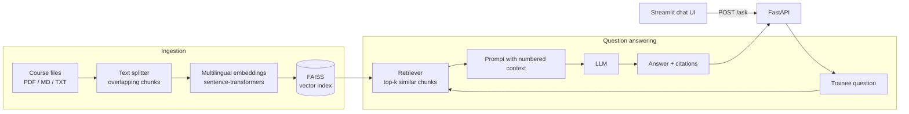

# 🎓 Course Assistant — Bilingual RAG Teaching Assistant

An AI teaching assistant that answers trainees' questions **from the course material only**, in **Arabic or English**, and cites the exact sources it used. Built with **LangChain**, **FAISS**, **FastAPI**, **Streamlit** and **Docker**.

> مساعد تعليمي ذكي يجيب على أسئلة المتدربين من محتوى المقرر فقط، بالعربية أو الإنجليزية، مع ذكر المصادر.


---

## Why this project?

Trainees in AI bootcamps ask the same questions many times, often outside class hours. General chatbots answer confidently but may contradict the course or invent facts. This assistant uses **Retrieval-Augmented Generation (RAG)** so every answer is grounded in the instructor's own slides and notes, with numbered citations trainees can check.

## Features

- **Bilingual:** multilingual embeddings so an Arabic question can retrieve English material and vice versa; answers come back in the question's language.
- **Grounded answers with citations:** the model only uses retrieved context and cites it as `[1]`, `[2]`.
- **Bring your own material:** drop PDFs, Markdown or text files into `data/` and call `/ingest`.
- **Model-agnostic:** works with OpenAI or any OpenAI-compatible server, including a **free local model via Ollama**.
- **Production-minded:** REST API with validation, Dockerfile with a non-root user and health check, Docker Compose, offline unit tests, and GitHub Actions CI.

## Architecture



## Quick start (Docker)

```bash
git clone https://github.com/<your-username>/course-assistant-rag.git
cd course-assistant-rag
cp .env.example .env        # add your OPENAI_API_KEY (or Ollama settings)
docker compose up --build
```

- Chat UI: http://localhost:8501
- API docs (Swagger): http://localhost:8000/docs

The first question downloads the embedding model and builds the index, so it takes a little longer.

## Run locally without Docker

```bash
python -m venv .venv && source .venv/bin/activate
pip install -r requirements-dev.txt
cp .env.example .env
python -m app.ingest                      # build the index
uvicorn app.api:app --reload              # start the API
streamlit run app/ui.py                   # in a second terminal
```

## Use a free local model (Ollama)

```bash
ollama pull qwen2.5:7b
```
Then in `.env`:
```
LLM_BASE_URL=http://host.docker.internal:11434/v1   # or http://localhost:11434/v1 without Docker
LLM_MODEL=qwen2.5:7b
```

## API

| Method | Endpoint  | Description                                   |
|--------|-----------|-----------------------------------------------|
| GET    | `/health` | Health check                                  |
| POST   | `/ask`    | Ask a question, returns answer and sources    |
| POST   | `/ingest` | Rebuild the index after changing `data/`      |

```bash
curl -X POST http://localhost:8000/ask \
  -H "Content-Type: application/json" \
  -d '{"question": "ما هو فرط التخصيص وكيف أقلله؟"}'
```

```json
{
  "answer": "فرط التخصيص يحدث عندما يحفظ النموذج بيانات التدريب ... [1]",
  "sources": [
    {"id": 1, "source": "ml_fundamentals_ar.md", "page": null, "snippet": "..."}
  ]
}
```

## Tests

Tests run fully offline using fake embeddings and a fake LLM, so CI needs no API keys:

```bash
pytest -v
```

## Project structure

```
course-assistant-rag/
├── app/
│   ├── config.py      # settings from environment / .env
│   ├── providers.py   # embedding model and LLM factories
│   ├── ingest.py      # load -> split -> embed -> FAISS index
│   ├── rag.py         # retrieval + prompt + citations
│   ├── api.py         # FastAPI service
│   └── ui.py          # Streamlit chat interface
├── data/sample/       # sample course notes (Arabic + English)
├── tests/             # offline unit and API tests
├── Dockerfile
├── docker-compose.yml
└── .github/workflows/ci.yml
```

## Design decisions

- **FAISS** keeps the project self-contained with no external database; the vector store sits behind LangChain's `VectorStore` interface, so switching to Chroma, Pinecone or Milvus is a small change in `ingest.py`.
- **Multilingual MiniLM embeddings** run on CPU, cost nothing, and map Arabic and English text into the same vector space.
- **Overlapping chunks (800 / 120)** keep definitions and their explanations together; both values are configurable.
- **Strict grounding prompt** tells the model to say when the material doesn't cover a question instead of guessing.

## Roadmap

- Evaluation set with retrieval hit-rate and answer faithfulness metrics
- Hybrid search (BM25 + vectors) and re-ranking
- Conversation memory for follow-up questions
- Instructor dashboard showing the most-asked topics

## Author

**Nora Albabtain** — AI Instructor · [LinkedIn](https://linkedin.com/in/nora-albabtain-916017336)

## License

MIT
